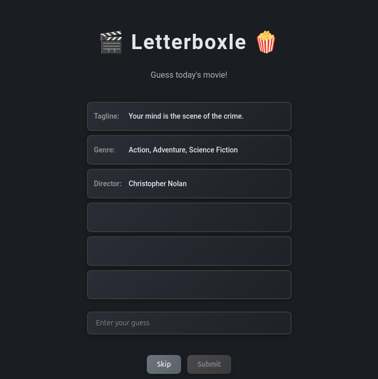

# Letterboxle (frontend)


React frontend for Letterboxle, a daily movie guessing game inspired by Wordle. You get six guesses to name the movie of the day, and every miss reveals a new hint: tagline, genre, director, two actors, then the year.

**[Play at letterboxle.pedroaguia8.dev](https://letterboxle.pedroaguia8.dev)** · API and data: [Letterboxle-backend](https://github.com/pedroaguia8/Letterboxle-backend)

<a href="https://letterboxle.pedroaguia8.dev"></a>

## How it works

- **React 19 + Vite**, React Router and plain CSS. All game state lives in one component; no state library.
- **Movie search** runs client-side over the full movie list, fetched once. Matching ignores accents and punctuation ("amelie" finds "Amélie", "spiderman" finds "Spider-Man") and ranks exact matches, then title prefixes, word prefixes and substrings, so an exact match is never cut from the suggestions. The rules are pinned down case by case in Vitest tests (`src/movieMatching.test.js`).
- **Share results** as a Wordle-style emoji grid copied to the clipboard.

## Running locally

```bash
npm ci
npm run dev    # Vite proxies /api to the Go backend on localhost:8080
npm test       # Vitest
npm run lint
npm run build
```

## Deployment

- Two-stage Docker build: Node builds the app, then an unprivileged Nginx image serves the static files as a non-root user. Base images are pinned by digest and kept current by Renovate.
- GitHub Actions runs lint, tests and the build on every pull request, and on `main` pushes the image to GHCR. A CD workflow then deploys that exact image to my own Linux server over SSH, where it runs as a rootless Podman container behind Caddy and a Cloudflare Tunnel. The deploy rolls back on its own if the health check fails.
